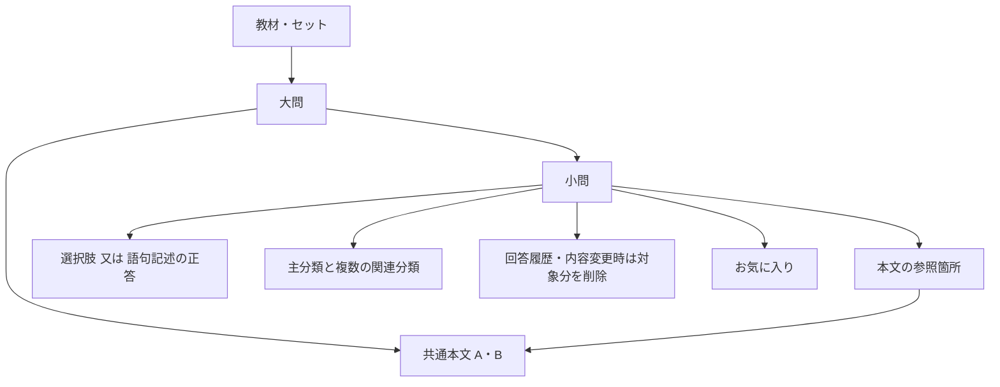

# 大問・共通本文・語句記述に対応する実装案

確認日：2026年10月27日。ユーザー承認後に実装・ローカル検証を完了。実装結果・変更ファイル・検証範囲は[実装記録](grouped-question-implementation-20261027.md)を参照。以下の現行コード表・行番号は承認時点の設計根拠であり、実装後の行番号を示すものではない。

## 1. 推奨する変更

「教材／セット → 大問 → 小問」の構造を加える。大問に共通本文A・B、小問に参照箇所と回答形式を持たせる。小問には既存の問題IDを使い、お気に入り・既存URLを継承する。回答履歴は内容変更の影響を受ける小問について削除してよい。

時代や地域の異なる選択肢の文章自体は、現在も入力できる。追加が必要なのは、共有する文脈、語句記述、複数の学習範囲、教材ごとの構成である。履歴を過去の問題文とともに保存する機能は、今回の実装対象から外す。

最初の対応範囲は、四択と語句記述、大問内の順次演習、条件付き単問演習、管理・公開・バックアップまでとする。制限時間、一括提出、論述採点は別の追加機能として扱う。

## 2. 現行コードで確認した制約

| 制約 | 現行の根拠 | 必要な変更 |
| --- | --- | --- |
| セット内の通し番号だけで問題を管理 | `frontend/server/database/migrations/001_preserve_rails_schema.sql:8`、同`:64` | 大問、小問の表示番号、共通本文の親子関係 |
| すべての問題で四択・正答1件を要求 | `frontend/server/services/learning-validation.ts:153` | `single_choice`と`short_text`の判別 |
| 履歴の選択肢IDが必須 | `frontend/server/database/migrations/001_preserve_rails_schema.sql:20`、`frontend/server/services/learning.ts:124` | 短答の入力・採点・履歴表示 |
| 章・節は1組のみ | `frontend/server/services/learning-validation.ts:128` | 既存の主分類に加え複数の関連分類 |
| 通常の本文は文字列をそのまま表示 | `frontend/app/components/QuestionContentBlocks.vue:46` | 下線や参照先を安全に構造化 |
| 全教材で固定の問数を使用 | `frontend/shared/examConfig.ts:19`、`frontend/server/services/learning-writer.ts:45` | 教材別の構成と公開検査 |
| 固定問数から演習位置の全組合せを作る箇所がある | `frontend/app/utils/practiceSequence.ts:8` | APIが返す実在する公開小問の一覧を使用 |
| 本文・番号・分類・解説・出典の変更で履歴を削除 | `frontend/server/services/learning-writer.ts:26`、同`:84` | 削除の方針を活用し、共通本文の更新が影響する小問にも適用する |
| 問題アーカイブはv1の属性のみ許容 | `frontend/server/operations/content.ts:16`、同`:70` | v2の追加とv1読込の維持 |
| 公開する出典は現在HTTPS URLが必須 | `frontend/server/services/learning-validation.ts:112`、同`:167` | 書籍の書誌・確認箇所をURLなしでも保存する構造化出典 |

現在の設定は体験用1セット・5問である。`questions_per_exam`を30に変えるだけでは、既存5問の公開検査やナビゲーションが崩れる。

## 3. 教材の構成を3種類に分ける

| 種別 | 公開する構成 | 用途 |
| --- | --- | --- |
| 従来の体験教材 | 現在の5問・大問未所属を維持 | 既存問題とURLの継続 |
| 単独大問の演習教材 | 1大問・7問又は8問 | 今回作成した大問1つを登録して演習可能にする |
| 歴検形式の模試 | 4大問・各7問又は8問・合計30問 | 8・7・8・7問等の1回分 |

単独大問を公開するために、残る3大問の完成を必須にしない。表示名でも「大問演習」と「30問の模試」を区別する。

試験構成の正本は引き続き`config/exam.json`とし、既存の5問設定を残したまま形式を追加する。以下は追加部分の案で、現在の設定を書き換えたものではない。

```json
{
  "formats": {
    "group_practice": {
      "group_count": 1,
      "allowed_group_question_counts": [7, 8]
    },
    "rekiken_mock": {
      "group_count": 4,
      "question_count": 30,
      "allowed_group_question_counts": [7, 8]
    }
  }
}
```

`exam_sets.format_code`で適用する形式を選ぶ。従来形式の問数は既存の`questions_per_exam`から読み、別の5という固定値を増やさない。各大問の予定問数はDBに7又は8として保存する。模試ではその合計と実問題数の両方が30か確認する。

既存の第1セットを30問へ変換しない。追加教材用の番号枠は設定を明示更新して確保する。単独大問から模試へ拡張する場合も、既存小問のID・通し番号を保ち、追加大問がそろった時点で形式と公開対象をトランザクションで切り替える。

## 4. データ構造



追加するテーブルの責務は次のとおり。

| テーブル案 | 主な情報・制約 |
| --- | --- |
| `exam_sets` | `exam_number`、タイトル、`format_code`、公開状態。番号は一意。設定で許可された番号・形式を使用 |
| `question_groups` | ID、セット番号、大問番号、タイトル、予定小問数、公開状態。セット内の大問番号は一意 |
| `group_passages` | ID、大問ID、ラベルA/B等、表示順、`content_blocks`。同じ大問でラベル・表示順を重複させない |
| `question_passage_references` | 小問ID、本文ID、アンカーID（NULL可）、表示順。同じセット・大問の本文だけを参照可能にする。NULLは本文全体への依存を表す |
| `question_accepted_answers` | 小問ID、模範表記、許容表記、表示順。一般向けの問題取得APIから返さない |
| `question_topic_links` | 小問ID、章・節コード、主／関連の区分。組合せと重複を検査する |

`questions`に`group_id NULL`、`group_question_number NULL`、`answer_type DEFAULT 'single_choice'`、`source_references jsonb`、`content_version`を追加する。`content_version`は出題後の内容変更を検知する整数であり、過去本文を保存するテーブルへの参照ではない。既存の`id`、`exam_number`、`question_number`は保持する。

教材・大問・小問の管理編集には`lock_version`を持たせ、保存時の競合を検知する。これは編集ごとに増える番号であり、過去版の本文は保存しない。回答への影響だけを表す`content_version`とは役割を分ける。

- `question_number`は既存URLを維持するためのセット内識別番号。表示順は大問番号と大問内小問番号で管理する。
- 大問への所属と小問番号は両方未設定、又は両方設定とする。大問内番号は一意にする。
- 大問の所属セットと小問のセットが一致することを、複合外部キー又はWriterの検証とDB制約で保証する。
- 大問の並べ替えで、既存の問題ID・選択肢ID・URL用番号を振り直さない。
- 従来5問は大問未所属のまま利用できる。自動で一つの大問へまとめない。

新SQLは現在の最終004に続く番号へ追加する。実装時に空き番号を確認し、適用済みSQLを変更しない。Prismaへの変更は行わず、既存の`pg`と`db:migrate`を使う。

## 5. 本文A・Bと参照箇所

共通本文は大問に一度だけ保存し、各小問から必要な本文と箇所を参照する。本文Aの(a)と本文Bの(a)が同じIDにならないよう、表示ラベルと内部IDを分ける。

本文のブロック・参照部分には安定したIDを持たせ、限定的なインライン要素で下線・強調・空欄を表す。文字位置の数値や`(a)`の文字列検索だけでは結び付けない。既存の通常文・引用・表・穴埋めブロックは再利用する。

概念的な形は次のとおり。既存の`text`ブロックは引き続き読めるようにし、新旧型を共有の型定義と検証で扱う。

```ts
type PassageInline =
  | { type: 'text'; text: string }
  | { type: 'anchor'; id: string; label: string; text: string; underline: true }
  | { type: 'blank'; id: string; label: string }

type PassageReference = { passage_id: number; anchor_id: string | null }
```

公開前に、参照切れ、重複アンカー、別大問の本文への参照を検査する。参照先の削除・変更は、影響する小問一覧を管理画面で示し、関連変更を一つのWriterトランザクションで保存する。描画はVueの要素で行い、任意HTMLの保存・`v-html`には切り替えない。

`anchor_id = NULL`は本文全体を読む小問、非NULLは本文内の特定箇所への参照とする。本文全体リンクの重複も拒否する。本文を更新した場合は、アンカーの有無にかかわらず、その本文IDへのリンクを持つ全小問を内容バージョン更新・履歴削除の対象にする。表示上の参照位置と、内容変更の影響範囲を混同しない。

## 6. 回答形式と語句記述

採点形式は最初に2種類を実装する。Ⅰ・Ⅱ正誤や年代整序が四択の場合は、引き続き`single_choice`として扱える。

```ts
type AnswerInput =
  | { answer_type: 'single_choice'; selected_choice_id: number; question_version: number; submission_key: string }
  | { answer_type: 'short_text'; submitted_text: string; question_version: number; submission_key: string }
```

語句記述は、管理者が模範解答と許容表記を登録する。初期の照合はNFKC正規化と前後空白の除去を共通処理とし、別名・異体字は明示登録する。語中の空白除去や広い曖昧一致を自動で有効にしない。「漢字3字」「カタカナ」等は入力条件として保存し、画面とサーバーの両方で確認する。

公開時は四択に全選択肢・正答1件、語句記述に模範解答・許容表記1件以上を要求する。短答にダミーの4選択肢を作らない。公開済み問題の回答形式を変更する場合は、既存の履歴と選択肢を持つ問題を上書き変換せず、新しい小問として扱う。

### 書籍だけを根拠とする問題の出典

今回のように、書籍の原画像で照合した自作問題も保存・公開できる出典型を追加する。現在の`source_text`のHTTPS必須検査を、そのまま新形式へ強制しない。

- `book`：書名、出版社、版・刊行年、章節や項目名、確認できた掲載位置を保存する。URLは任意とし、指定する場合だけHTTPS等を検査する。出版社の案内URLは書誌案内として扱い、歴史記述の本文確認の代わりにしない。
- `web`：資料名、実際に確認したHTTPS URL、確認日を保存する。認証情報入りURLやローカルファイルURLは拒否する。
- 印刷頁・電子書籍の位置を区別し、未確認の印刷頁を作らない。個人が作成したPDFの通し頁・原画像への参照はローカル専用の照合記録に残し、公開用の書誌と分ける。
- 原資料ファイル・画像・全文OCR・端末内のパスは問題DBへ取り込まない。公開後の出典表示は書誌と確認項目等から組み立てる。
- 既存`source_text`はそのまま読める互換形式として保持し、新規には`source_references`を使用する。公開時は有効な旧形式、又は構造化出典1件以上を要求する。出典の二重管理を避け、新形式を保存した問題の旧文字列を独立編集させない。
- 出典の編集UI、回答後の表示、アーカイブv2へ同じ型を通す。回答前の一般APIへは返さない。AGENTS.mdの出典形式規則も、実装時に新旧の扱いを明記して更新する。

## 7. 内容変更時の履歴削除と更新検知

ユーザーの履歴削除許容に合わせ、問題の不変版・共通本文の過去版・履歴の版参照テーブルを導入しない。現行Writerの履歴削除方針を拡張する。

1. 小問の本文・選択肢・正答・解説・出典・許容表記・入力条件が変わったら、その小問の回答履歴を削除し、`content_version`を増やす。
2. 共通本文・参照部分が変わったら、その本文を参照する小問の履歴を削除し、それぞれの内容バージョンを増やす。大問の共通本文全体を読む設問では、その依存関係を明示登録する。
3. 共通本文と影響する小問の更新・履歴削除を一つのトランザクションで確定する。参照先の追加・解除でも、更新前後の依存関係から影響対象を求める。
4. 表示順・分類だけの変更は、回答内容が変わらないため削除不要とする。同じ内容の再保存でも履歴削除やバージョン増加を繰り返さない。
5. 出題後に内容が変わった場合、回答APIは送信された`question_version`と現在の`content_version`を比較し、異なれば409で再読込を案内する。古い表示内容のまま新版で採点しない。

削除対象は、変更の影響を受ける小問の回答履歴とする。問題・選択肢・お気に入り・利用者・他の小問の履歴を連動して消さない。管理画面では保存前に影響する小問と履歴件数を表示する。問題の構造を追加するだけの初期移行で、履歴の一括削除は必要ない。

`answer_histories`は回答形式、入力語、採点時の内容バージョン、送信キーを追加する。`selected_choice_id`のNOT NULLは、選択回答と短答回答の排他的なCHECK制約へ置き換え、選択肢への外部キーは維持する。入力語や正答を運用ログへ出さない。

新形式のログイン回答には`submission_key`を付け、`UNIQUE(user_id, submission_key)`で二重保存を防ぐ。同じキー・同じ内容バージョン・同じ回答の再送は既存結果を返し、異なる問題や入力へのキー再利用は拒否する。履歴が内容変更により削除済みなら、古いバージョンでの再送は409となる。既存履歴のキーはNULLとする。キーを持たない旧互換入力は二重保存防止の保証対象外とし、改修後の画面は常にキーを送る。匿名回答は現在と同じく学習履歴を保存しない。

Writerは引き続き`learning-writer.ts`を入口とし、問題編集・大問編集・公開切替・採点で共通のロック順序とトランザクション規則を使う。現在の`materialDigest`から配置・分類を分離し、共通本文への依存と短答の採点条件を内容変更の判定に加える。共通本文更新と採点が競合した場合も、旧内容の履歴が更新後に残らないことを検査する。

## 8. 横断分類と絞り込み

大問にはテーマを付け、小問へ章・節を一括継承しない。小問の既存主分類を残し、回答の判断に使う関連章節を複数登録する。既存問題は現行の章・節をそのまま主分類リンクへ移し、本文から関連分類を自動推定しない。

章・節の検索は主分類と関連分類のリンクを対象にする。従来の問題はリンクが1組なので検索範囲が保たれる。横断問題には「選んだ範囲の知識を使う横断問題も含みます」と説明する。

- 章と節は同じ分類リンク内で一致させる。別の章リンクと別の節リンクを独立に一致させない。
- その結果と文化史の指定をANDで結ぶ。0件なら0件として案内する。
- 文化史4区分は当面、既存の小問単位の主眼1区分を維持する。`is_art_history`との整合も保つ。
- 検索で小問が1つ一致しても、条件外の兄弟小問を検索結果へ追加しない。必要な共通本文は文脈として取得する。

この検索拡張は提案であり、現在の単一主分類ルール・DB値・検索処理を今回変更したものではない。実装時にAGENTS.md・分類運用・API仕様を合わせて更新する。

## 9. APIと画面

### 一般向けAPI

- 既存`GET /api/v1/questions/:id`に、教材種別、大問番号・タイトル、大問内小問番号、回答形式、入力条件、必要な共通本文・参照、`question_version`を追加する。
- 現行演習画面が使う`GET /api/v1/questions/next`も同じ公開DTOにそろえる。`serializePublicQuestion`相当を共通化し、ID指定・次問取得のどちらでも同じ参照文脈と回答型を受け取れるようにする。
- `GET /api/v1/exams`へ教材別の構成と実在する公開小問の一覧を追加する。トップ・サイドバー・順次／ランダム演習はこの一覧から組み立てる。
- 大問一覧・ナビ用として`GET /api/v1/exams/:number/groups`を追加する。表示順と利用可能な小問ID／通し番号を返す。
- 既存`POST /api/v1/questions/:id/answer`を回答形式別の入力へ拡張する。新画面は回答形式・内容バージョン・送信キーを必ず送信する。
- バージョンがない従来の`{selected_choice_id}`は、移行対象の既存四択で、回答内容の更新が一度もない場合に限って受ける。移行時に既存四択だけ互換対象を記録し、内容更新時に対象から外す。新規問題・短答・更新済み問題ではバージョンを要求し、不足や不一致は409で再読込を案内する。
- 履歴の取得・一覧・復元は`selected_choice`必須の型をやめ、回答形式別に入力と結果を返す。

回答前には、正答フラグ・許容表記・模範解答・解説・出典を返さない。大問一覧や共通本文の取得にも、親教材・大問・小問の公開状態と利用資格をAPI側で適用する。下書きの兄弟小問や有料範囲の情報を一覧から漏らさない。分類コードは出題範囲の情報として必要に応じ回答後に表示し、語句記述の正答を推測できる狭すぎるヒントにしない。

### 管理画面

管理APIは既存の管理者認証を共通適用し、次の契約を追加する。パスは提案であり、今回作成済みのAPIではない。

| API案 | 操作とトランザクション境界 |
| --- | --- |
| `GET /api/v1/admin/exams` | 下書きを含む教材と大問の管理用一覧。管理者だけに返す |
| `GET/PATCH /api/v1/admin/exams/:number` | 教材の形式・予定構成・下書きの取得／編集。設定済み番号と形式を検査 |
| `POST /api/v1/admin/exams/:number/groups` | 大問の下書き作成。所属セットを確定 |
| `GET/PUT /api/v1/admin/question_groups/:id` | 大問、共通本文、参照、小問の所属・順序をまとめて取得／保存。同時に変更する参照先と参照元を一つのWriterトランザクションで検査・保存 |
| `POST /api/v1/admin/questions`、`PATCH /api/v1/admin/questions/:id` | 既存の小問CRUDへ大問所属、回答型、短答正答、複数分類、構造化出典、本文参照を追加 |
| `POST /api/v1/admin/exams/:number/validate` | 下書きの公開可否と、不足する大問・小問・項目を返す。読取検査 |
| `POST /api/v1/admin/exams/:number/publish` | 指定した下書き状態に対し、ロック取得後に公開条件を再検査して構成・公開状態を一括切替 |
| `DELETE /api/v1/admin/question_groups/:id` | 空の未公開下書きのみ物理削除。既存小問・履歴があれば非公開化して関係を保持 |

更新・並べ替え・公開には期待する`lock_version`を付け、競合は409とする。大問一括保存は配列から外れただけの小問を自動削除せず、解除・非公開化等の意図を明示させる。公開検査の成功後に別の編集が入った場合でも、公開APIが再検査するため未検証の構成は公開されない。

「教材 → 大問 → 共通本文／小問」の構成一覧を左に、編集とプレビューを右に置く。スマートフォンでは構成一覧を折り畳み、縦1列にする。

大問にはタイトル、A・B等の本文、参照マーク、予定問数を入力する。小問は既存`AdminQuestionForm`を拡張し、四択／語句記述を切り替える。語句記述には模範解答・許容表記・入力条件を表示する。大問全体のプレビューと、1小問ずつの学習表示を確認できるようにする。

未公開の下書きは不足を保存できるようにする。型不正・別セットへの参照・重複IDは保存時に拒否し、本文・正答等の未完成は公開前検査で具体的な大問・小問・項目を示す。

本提案の大問教材は、公開中であれば全体の公開条件を満たす完成入力だけを直接更新する。未完成の状態で保存したい場合は、教材全体を非公開化して下書きに戻し、修正完了後に再公開する。過去版や公開用・編集中の二重本文を保存しない簡略設計とする。非公開の兄弟大問を追加する場合も公開対象へは含めず、形式切替時に完成した全構成をまとめて検査する。

### 演習画面

既存`/practice/{examNumber}/{questionNumber}`を維持し、表示を「大問1・問3」のようにする。通し番号と大問内の番号を区別する。

- PC・SPとも共通本文の下に現在の小問を置き、直列に読む。通常の設問と同じ最大900pxの幅を使い、全体をスクロールして操作する（2026年10月27日の表示変更依頼を反映）。
- SP：共通本文を初回は展開し、折り畳み可能にする。小問の参照を押すと本文を開き、対象部分へ移動・強調する。
- 同じ教材・大問・本文では本文コンポーネントと開閉状態を保持し、読み込み中は設問部分だけを置き換える。別本文や本文改訂時は更新し、認証・利用条件・絞り込みの変更やエラーでは保持を解除する。設問切替ではNuxt既定のページ先頭への移動を維持する。
- お気に入りは分類表示の右端・上端へ置き、分類の長さ・文化史表示の有無・設問読み込み中で位置を変えない。
- 単問のランダム演習・履歴・お気に入りから開いた場合も、必要な共通本文を付ける。
- 一般画面の親は「模擬試験n」。サイドバーの開閉では「大問m タイトル」だけを表示し、各大問の最初の公開小問へ進む。親リンクは模擬試験の公開順の先頭へ進む。未収録の大問をリンクとして補わない。
- 本文側のh1は大問番号と大問タイトル。小問番号は設問パネルの見出しに分け、本文内の小問ナビゲーションは保持する。
- 条件指定は模擬試験と章節・文化史を組み合わせ、小問番号selectorを設けない。新規URLはexamsと分野/順序/seedだけを使い、選択した模擬試験の全公開小問を対象にする。旧questionsパラメータのURLは互換を保つ。
- 大問を順に解く場合は大問内の小問順を保つ。四択と短答の入力・結果表示は共通コンポーネントで分岐する。

## 10. 公開前検査

教材種別に応じて公開対象をトランザクション内で検査する。

1. 従来教材は既存問数、単独大問は1大問7/8問、模試は4大問・各7/8問・計30問。
2. 大問と小問の表示番号・通し番号・所属・参照の整合。
3. 全小問の本文・解説・出典と、回答形式ごとの正答条件。
4. 共通本文・参照マーク・表の完成、参照切れの不存在。
5. 公開対象の大問・全小問がそろい、下書き・非公開の混入がないこと。

現在の`validateCompleteExam`は番号の登録有無を中心に検査しているため、単にその問数を30へ増やさず、教材形式に応じた公開検査へ拡張する。

## 11. 実装ファイルと順序

| 段階 | 主な対象 | 完了する機能 |
| --- | --- | --- |
| 1. 保存と回答の基盤 | 新番号のSQL、`frontend/shared/types/learning.ts`（新規）、`learning-validation.ts`、`learning-writer.ts`、`learning.ts` | 新しい階層・回答型・内容バージョンと対象履歴削除。既存四択を継続 |
| 2. 共通本文と語句記述 | `QuestionContentBlocks.vue`、`admin/AdminContentBlockEditor.vue`、`admin/AdminQuestionForm.vue`、共通本文編集・`QuestionAnswerForm.vue`・`AnswerResultPanel.vue`（新規） | 今回の8小問を下書き登録し、大問全体をプレビューできる |
| 3. 演習・検索・公開 | `practice/[examNumber]/[questionNumber].vue`、`index.vue`、`ExamSidebar.vue`、`practiceSequence.ts`、`examCatalog.ts`、`history.vue`、`favorites.vue`、`config/exam.json`、共有設定型 | 単独大問・30問模試、章節横断検索、既存履歴／お気に入りからの利用 |
| 4. 運用と最終検証 | `frontend/server/operations/content.ts`、`restore-drill.ts`、関連テスト、`docs/architecture.md`、`docs/customization.md`、`docs/verification.md`、AGENTS.md | アーカイブv2・復元・整合した運用手順 |

表のファイル名は既存の`frontend/app/`、`frontend/server/services/`等の配置に従う。共通本文・大問編集の新規コンポーネントの具体名は実装時に決める。各段階を順に検証し、4段階が通った時点で一般利用向けの完成とする。データ保存だけを演習機能完成とはしない。

## 12. 移行・アーカイブ・検証

適用前に既存DBの安全なバックアップを取り、使い捨ての末尾`_test`DBで移行・復元を検証する。実問題を`content/questions.json`から再投入せず、既存の問題・選択肢・お気に入りのID、本文、正答、日時、公開状態を比較する。構造追加だけの移行では既存履歴も保持できる。後の内容更新に伴う対象履歴の削除は、許容された操作として対象・件数を別に記録する。

問題アーカイブはv2で形式・大問・共通本文・参照・短答正答・関連分類・構造化出典を扱い、v1の読込も残す。持ち運び用の参照キーをDB内IDへ対応付ける。空DB限定importは維持し、通常の更新には管理APIと共通Writerを使用する。アーカイブのexport/importを既存ID・学習履歴を保つDBバックアップの代わりにはしない。

検証は合成データで以下を行う。原資料PDF・全文OCR・ローカル専用資料をテストfixtureやCIへコピーしない。

- 体験5問、単独大問7/8問、模試4大問30問の共存。29/31問、6/9問の大問等の不正構成を公開できないこと。
- 共通本文A/Bと参照の表示、本文改訂・アンカー削除・並べ替え、複数大問間の所属検査。
- 本文全体リンクと特定アンカー参照の双方が共通本文更新の影響対象になること。公開中の未完成入力を拒否し、非公開化した下書きなら保存できること。
- 四択・短答の正常回答、未入力、許容表記、誤字、入力条件、再送、二重送信。
- 書籍のみの出典、URL任意の書誌、HTTPS必須のWeb資料、新旧出典形式、回答前の出典非公開とローカル資料の不混入。
- 二重送信は画面の無効化に加え、送信ごとのキーで同じ回答を重複保存しない処理を追加する。別の解き直しは新しい回答として扱う。
- 更新中の回答競合、古い内容バージョンへの409、共通本文の変更が影響する小問の履歴だけが削除されること。
- バージョンなし旧入力は未更新の移行済み四択だけ受け入れ、更新済み・新規・短答では再読込を要求すること。ID指定・next取得の公開DTOが一致すること。
- 関連章節と文化史のAND、章と節の同じリンクでの一致、重複結果の排除、0件時、条件外の兄弟小問の不混入。
- 未認証・権限なし・利用資格なし・下書き／非公開の拒否、回答前の正答情報非公開。
- 管理画面から保存し、再読込・再編集・削除・並べ替え後もDBと表示が一致すること。
- v1/v2アーカイブ、DB復元後の大問・短答・内容バージョンと履歴、移行対象外の既存データの保全。
- PC1440px、SP390px・320pxで共通本文、参照移動、入力、結果、ナビゲーションを実操作すること。

実装時のフロントテスト・型検査・ビルド・隔離DBテストはPC負荷を抑えて順番に実行する。現時点でこれらの機能テストを実施済みとはしない。

## 13. 今回の到達点

この提案は、現行コードの読取調査と独立した設計レビューを対象とする。アプリコード・設定・DB・問題データは変更しない。実装の着手、実際の問題登録、コミット・push・公開は、それぞれの依頼範囲に従う。
